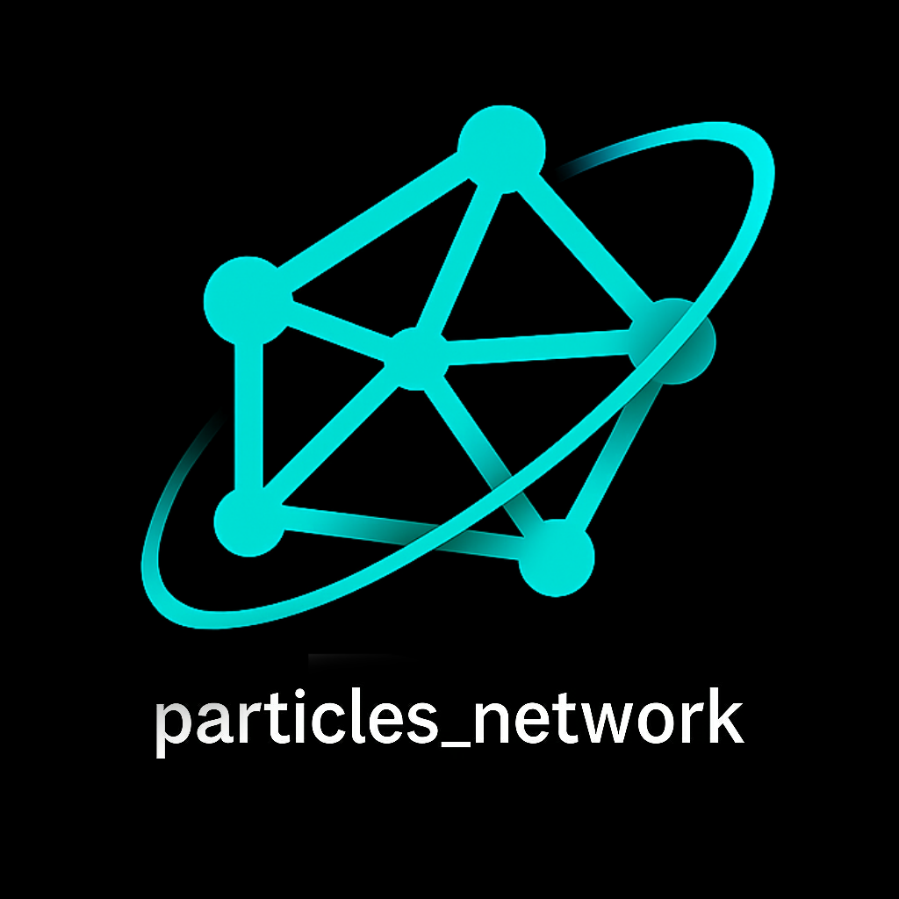

<div align="center">

# Particles Network

**High-performance, physics-driven particle simulation engine for Flutter — meticulously crafted with deep respect for user devices, battery life, and hardware resources.**

<a href="https://github.com/abod8639/Particles_Network">
  
</a>


[]()
[](https://pub.dev/packages/particles_network/score)
[]()

[](https://pub.dev/packages/particles_network)

[](https://pub.dev/packages/particles_network/score)
[](https://pub.dev/packages/particles_network)
[](https://opensource.org/licenses/MIT)
[](https://github.com/abod8639/particles_network)

[](https://codecov.io/gh/abod8639/particles_network)
[](https://pub.dev/packages/particles_network)
[](https://particle-network-example.web.app/)

[Live Demo](https://particle-network-example.web.app/) • [Features](#features) • [What's New](#whats-new) • [Quick Start](#quick-start) • [Algorithms](#procedural-noise-algorithms) • [Controller](#controller-usage) • [Error Handling](#error-handling) • [Architecture](#architecture--performance)

</div>

<!-- <p align="center">
  <a href="https://github.com/abod8639/Particles_Network/actions"></a>
  <a href="https://pub.dev/packages/particles_network"></a>
  <a href="https://codecov.io/gh/abod8639/Particles_Network"></a>
  <a href="https://opensource.org/licenses/MIT"></a>
</p>

[](https://pub.dev/packages/particles_network/score)
<p align="center">
  <a href="https://github.com/abod8639/Particles_Network/stargazers"></a>
  
  
  <a href="https://particle-network-example.web.app"></a>
</p> -->

---

<p align="center">
  <a href="https://github.com/abod8639/Particles_Network"><b>GitHub</b></a> •
  <a href="https://pub.dev/packages/particles_network"><b>Pub.dev</b></a> •
  <a href="https://particle-network-example.web.app"><b>Live Demo</b></a> •
  <a href="#configuration-options"><b>API Reference</b></a>
</p>

</div>

> ### Engineering Philosophy: Built with Respect for Hardware & Developers
> **Particles Network is built differently.** Designed from the ground up with obsessive attention to detail, every data structure, spatial query, and draw call is engineered with surgical precision to minimize memory allocations, eliminate garbage collection pauses, and deliver silky-smooth 60/120 FPS animations without exhausting your users' device resources.

---

## Table of Contents

- [Engineering Philosophy](#-engineering-philosophy-built-with-respect-for-hardware--developers)
- [Features](#features)
- [Demo](#demo)
- [Live Demo](#live-demo)
- [Performance Benchmarks](#performance-benchmarks)
- [Quick Start](#quick-start)
- [Installation](#installation)
- [Platform Support](#platform-support)
- [Configuration Options](#configuration-options)
  - [Touch Features Configuration](#touch-features-configuration)
- [Gravity Simulation Guide](#gravity-simulation-guide)
  - [Global Gravity](#1-global-gravity)
  - [Point Gravity (Attractors & Repellers)](#2-point-gravity-attractors--repellers)
- [Architecture & Performance](#architecture--performance)
- [Examples](#examples)
- [Troubleshooting](#troubleshooting)
- [FAQ](#faq)
- [Migration Guide](#migration-guide)
- [Contributing](#contributing)
- [License](#license)

---

## Features

* **Physics & Force Engine**
  * **Dual Gravity Modes**: Seamless simulation of directional Global gravity and Point-source (attraction/repulsion) gravity.
  * **Mass-Proportional Dynamics**: Particle mass scales with radius; heavier nodes resist velocity shifts naturally.
  * **Realistic Gesture Dynamics**: Touch attraction, viscous damping, velocity capping, and smooth deceleration recovery.
  * **Trajectory Preservation**: Maintains smooth inertia vectors during deceleration and settling.

* **High-Throughput Rendering & Zero Allocations**
  * **Adaptive Performance Scaling (`enableAdaptivePerformance`)**: Auto-balances connection distance and density when frame rate drops, ensuring consistent 60/120 FPS.
  * **Batched Line Rendering (`fastLineRendering`)**: Combines line segment coordinates into flat `Float32List` buffers rendered in a single `canvas.drawRawPoints` call.
  * **Bounded $O(N)$ Connections (`maxConnectionsPerParticle`)**: Enforces per-node degree limits to prevent $O(N^2)$ exponential slowdowns in crowded views.
  * **Adaptive Density (`adaptiveDensity`)**: Automatically scales down connection radii in dense clusters.
  * **Zero-Allocation Color LUT**: Precomputed 256-level opacity table eliminates per-frame `Color` allocations and Garbage Collection (GC) pauses.
  * **Spatial Partitioning**: Hierarchical `CompressedQuadTree` structure delivers $O(\log N)$ neighbor lookups.
  * **Touch Inactivity Bypass**: Bypasses proximity checks and force routines when no pointer is active.

* **Developer Friendly**
  * Zero external dependencies beyond Flutter SDK.
  * Fully reactive to screen resize and parent layout constraints.
  * Direct exports of core classes (`ParticleNetwork`, `GravityType`, `TouchFeatures`).

---

## Demo

<p align="center">
  
</p>

<p align="center">
  <table align="center">
    <tr align="center">
      <td><b>Default Network</b></td>
      <td><b>Bold Connections</b></td>
      <td><b>Global Gravity</b></td>
    </tr>
    <tr>
      <td></td>
      <td></td>
      <td></td>
    </tr>
    <tr align="center">
      <td><b>Mass-based Gravity</b></td>
      <td><b>Optimized Density</b></td>
      <td><b>Stroke Mode</b></td>
    </tr>
    <tr>
      <td></td>
      <td></td>
      <td></td>
    </tr>
  </table>
</p>

---

## Live Demo

Experience interactive physics and high frame rates directly in your browser:

<p align="center">
  <a href="https://particle-network-example.web.app">
    
  </a>
</p>

---

## Performance Benchmarks

### Real-device frame timings (Galaxy S10, Impeller, profile mode, full screen)

| Scenario | `LineRenderer.stroke` | `LineRenderer.vertices` |
| :--- | :---: | :---: |
| 500 particles, lines (default `lineDistance: 100`) | 15.4 FPS (raster 61 ms) | **63.8 FPS** (raster 4.9 ms) |
| 1,000 particles, lines | 4.2 FPS | **41.8 FPS** |
| 2,000 particles, `maxConnectionsPerParticle: 5` | 26.0 FPS | **62.4 FPS** |
| 5,000 particles, `maxLinesPerFrame: 4000` | 33.4 FPS | **62.8 FPS** |
| 5,000 particles, `maxLinesPerFrame: 15000` | 9.6 FPS (raster 109 ms) | **64.0 FPS** (raster 8.4 ms) |
| 10,000 particles, `maxLinesPerFrame: 15000` | 9.0 FPS | **60.2 FPS** |
| 20,000 particles, `maxLinesPerFrame: 15000` | — | **61.8–64.5 FPS** |

| Scenario | FPS | Raster p50 |
| :--- | :---: | :---: |
| 500 particles, lines, `enableAdaptivePerformance` | 63.6 | 14 ms |
| 20,000 particles, no lines | 63.0 | 8 ms |
| 50,000 particles, no lines | 61.0 | 11 ms |

Stroked lines are the main cost: on this device each one takes roughly 7 µs of GPU time, while particles alone scale to 50,000 at 60 FPS. `LineRenderer.vertices` cuts the line cost by about 10x, and the cell-sorted search keeps the UI thread under budget: 20,000 particles with 15,000 lines hold 60 FPS. Beyond that the limit is the number of lines the UI thread can find and emit. Without a budget, 2,000 particles produce about 229,000 lines per frame and run at roughly 30 FPS. To reproduce on your own device:

```bash
cd example
flutter drive --profile --driver=test_driver/perf_driver.dart --target=integration_test/perf_benchmark_test.dart
```

### Test suites: 1.9.6 vs 1.9.7

| Suite | 1.9.6 (pub.dev) | 1.9.7 |
| :--- | :---: | :---: |
| Library unit tests (`flutter test`) | 276 / 276 pass | 324 / 324 pass |

The extra tests in the current source cover the line budget, frame-rate independent motion, the vertices renderer (including a pixel comparison against strokes) and the cell-sorted search (checked against brute force).

### Comparing against the published 1.9.6 release
`example/integration_test/perf_compat_test.dart` uses only constructor options that already existed in 1.9.6, so the same file measures both versions. To compare, run it once as-is (current source), then once with the example's dependency switched to the release:

```yaml
# example/pubspec.yaml
dependencies:
  particles_network: 1.9.6   # instead of `path: ../`
```

```bash
cd example
# With `path: ../`:
PERF_LABEL=current flutter drive --profile --driver=test_driver/perf_driver.dart --target=integration_test/perf_compat_test.dart
# After switching to `particles_network: 1.9.6` and running `flutter pub get`:
PERF_LABEL=v196 flutter drive --profile --driver=test_driver/perf_driver.dart --target=integration_test/perf_compat_test.dart
dart run tool/compare_perf.dart build/perf/v196.json build/perf/current.json
```

Alternate the versions (1.9.6, current, 1.9.6, current) and keep the machine otherwise idle. On emulators the GPU is translated to the host's GPU, so other GPU or build work on the host changes the results a lot.

### CPU-side microbenchmarks

| Benchmark Scenario | Standard Loop | Optimized Engine | Gain |
| :--- | :---: | :---: | :---: |
| **500 Particles (100 Frames Render)** | 4,608 ms (~46 ms/frame) | **496 ms** (~4.9 ms/frame) | **9.3x Faster** |
| **1,000 Particles (1,000 Frames Physics)** | ~120 ms | **45 ms** | **2.6x Faster** |
| **Framerate (500 Particles)** | ~21 FPS | **> 120 FPS** | Rock-solid smooth |
| **Line Color Heap Allocations** | Thousands of `Color`/sec | **0 (`_lineColorLut`)** | **100% GC pressure eliminated** |
| **Idle Touch Calculation Overhead** | Every frame | **0 (`isTouchActive`)** | **Zero idle CPU waste** |

---

## Quick Start

```dart
import 'package:flutter/material.dart';
import 'package:particles_network/particles_network.dart';

void main() => runApp(const MyApp());

class MyApp extends StatelessWidget {
  const MyApp({super.key});

  @override
  Widget build(BuildContext context) {
    return const MaterialApp(
      debugShowCheckedModeBanner: false,
      home: Scaffold(
        backgroundColor: Colors.black,
        body: ParticleNetwork(
          particleCount: 300,
          lineDistance: 80,
          particleColor: Colors.white,
          lineColor: Colors.tealAccent,
          touchActivation: true,
        ),
      ),
    );
  }
}
```

---

## Installation

Add `particles_network` to your `pubspec.yaml`:

```yaml
dependencies:
  particles_network: ^1.9.7
```

Then run:

```bash
flutter pub get
```

---

## Platform Support

| Platform | Support | Graphics Pipeline |
| :--- | :---: | :--- |
| **Android** | Full | Hardware Accelerated (Impeller / Skia) |
| **iOS** | Full | Metal Accelerated (Impeller) |
| **Web** | Full | WebAssembly & CanvasKit (`--wasm`) |
| **macOS** | Full | Metal Native |
| **Windows** | Full | DirectX Native |
| **Linux** | Full | OpenGL Native |

**Requirements:**
- Flutter SDK `>=3.27.0`
- Dart SDK `>=3.6.0 <4.0.0`

---

## Configuration Options

| Property | Type | Default | Description |
| :--- | :--- | :--- | :--- |
| `particleCount` | `int` | `60` | Number of particles in the system. |
| `maxSpeed` | `double` | `0.5` | Maximum base wandering velocity (px/frame). |
| `maxSize` | `double` | `1.5` | Maximum particle radius in pixels. |
| `lineWidth` | `double` | `0.5` | Thickness of connection lines. |
| `lineDistance` | `double` | `100.0` | Maximum distance threshold for drawing connections. |
| `particleColor` | `Color` | `Colors.white` | Particle fill or outline color. |
| `lineColor` | `Color` | `Color(0xFF64FFB4)` | Color of connection lines. |
| `touchColor` | `Color` | `Colors.amber` | Highlight color for particles near touch position. |
| `touchActivation` | `bool` | `true` | Enables touch and gesture interactions. |
| `touchFeatures` | `TouchFeatures` | `const TouchFeatures()` | Fine-grained touch physics and response configuration. |
| `hoverEffect` | `bool?` | `false` | Enables cursor tracking on desktop and web. |
| `isComplex` | `bool` | `false` | Optimized mode for high particle counts (300+). |
| `fill` | `bool` | `true` | `true` for filled circles, `false` for stroked outlines. |
| `drawNetwork` | `bool` | `true` | Whether to draw connection lines between particles. |
| `maxConnectionsPerParticle` | `int?` | `null` | Limits lines per particle, bounding edge complexity to $O(N)$. |
| `adaptiveDensity` | `bool` | `false` | Automatically reduces line distance in crowded areas. |
| `fastLineRendering` | `bool` | `false` | Batched single-call line drawing using `canvas.drawRawPoints`. |
| `enableAdaptivePerformance`| `bool` | `false` | Throttles line distance/connections when real frame cost (engine `FrameTiming`) exceeds the display's frame budget. |
| `maxLinesPerFrame` | `int?` | `null` | Line budget: shrinks connection radius so line count (the main GPU cost) stays near this value at any particle count. ~2000 sustains 60 FPS on a Galaxy S10. |
| `lineRenderer` | `LineRenderer` | `LineRenderer.stroke` | `LineRenderer.vertices` draws connections as triangles with one `drawVertices` call per opacity level: 4–10x faster on line-heavy scenes, with square line ends. |
| `frameRateIndependent` | `bool` | `false` | Integrates motion over real time so speed is identical at 60/90/120 Hz and smooth through dropped frames. |
| `gravityType` | `GravityType` | `GravityType.none` | Physics type: `none`, `global`, or `point`. |
| `gravityStrength` | `double` | `0.1` | Force intensity ($F = m \cdot a$). Negative values repel in point gravity. |
| `gravityDirection` | `Offset` | `Offset(0, 1)` | Direction vector for `GravityType.global`. |
| `gravityCenter` | `Offset?` | `null` | Focus position for `GravityType.point` (defaults to viewport center). |

---

### Touch Features Configuration

Fine-tune interaction dynamics with `TouchFeatures`:

| Property | Type | Default | Description |
| :--- | :--- | :--- | :--- |
| `force` / `pullForce` | `double` | `0.42` | Attraction strength toward the touch point. |
| `speed` / `decayRate` | `double` | `0.42` | Recovery rate back to cruising speed after touch release. |
| `damping` | `double` | `0.985` | Drag coefficient within the touch field. |
| `maxTouchSpeed` | `double` | `5.5` | Strict speed ceiling during touch attraction. |
| `lineDistance` | `double?` | `null` | Touch interaction radius (defaults to widget `lineDistance`). |

```dart
ParticleNetwork(
  touchActivation: true,
  touchFeatures: const TouchFeatures(
    force: 0.5,
    damping: 0.98,
    maxTouchSpeed: 6.0,
    decayRate: 0.02,
  ),
)
```

---

## Gravity Simulation Guide

### 1. Global Gravity
Simulates uniform directional gravity across the entire canvas (e.g. falling snow, floating bubbles).

```dart
ParticleNetwork(
  gravityType: GravityType.global,
  gravityStrength: 0.3,
  gravityDirection: const Offset(0, 1), // Downward fall
)
```

### 2. Point Gravity (Attractors & Repellers)
Simulates forces directed relative to a point source in space.
- **Attraction (Black Hole)**: Positive `gravityStrength` draws particles inward.
- **Repulsion (Force Field)**: Negative `gravityStrength` pushes particles outward.
- **Center**: If `gravityCenter` is omitted (`null`), it automatically centers on the widget.

```dart
// Repulsion shield focused on center
ParticleNetwork(
  gravityType: GravityType.point,
  gravityStrength: -1.2, // Negative = Repulsion
)
```

> [!NOTE]
> Particle **mass** is calculated automatically from radius. Larger particles naturally have greater inertia and resist velocity changes more than smaller ones.

---

## Architecture & Performance

### 1. Batched Flat-Buffer Line Rendering (`fastLineRendering`)
Instead of issuing individual `canvas.drawLine` commands per connection (which induces CPU-GPU context switches), `fastLineRendering: true` aggregates segment pairs into pre-allocated `Float32List` buckets and draws them with batched `canvas.drawRawPoints(PointMode.lines, ...)` calls.

### Triangle Line Renderer (`LineRenderer.vertices`)
Engine strokes are tessellated one segment at a time. With `LineRenderer.vertices`, the painter instead expands each connection into an indexed quad (4 vertices, two triangles) `lineWidth` thick, and submits each opacity level with one `canvas.drawVertices` call. The connections and their fades are the same as with strokes; only the GPU path changes.

### Cell-Sorted SoA Neighbour Search (`SortedSpatialGrid`)
Each frame, the batched and `fastLineRendering` paths counting-sort the visible particles by grid cell into flat `Float64List` coordinate arrays. Because cells are stored row-major, the candidates for a particle are just two contiguous memory ranges: the rest of its own cell plus the east cell, then the south-west, south and south-east cells. The pair loop therefore scans sequential typed memory instead of following per-cell linked lists and dereferencing `Particle` objects. The cell size is `max(r, sqrt(A / N))`, so the grid stays about the size of the particle count even when a line budget shrinks `r` to a few pixels.

### Line Budget (`maxLinesPerFrame`)
The number of connections grows as $\frac{N^2 \pi r^2}{2A}$, so it grows quadratically with particle count, and on real devices line rasterization dominates frame time. Given a budget $B$, the painter picks $r = \sqrt{\frac{2AB}{\pi N^2}}$ and corrects it every frame from the measured line count, which handles clustered particles. Frame cost then stays flat however many particles you add.

### 2. Bounded $O(N)$ Degree Limiting (`maxConnectionsPerParticle`)
Unbounded proximity checks in dense meshes produce up to $\frac{N(N-1)}{2}$ edges ($O(N^2)$). Capping connections per particle (e.g. `maxConnectionsPerParticle: 4`) provides a predictable $O(N)$ complexity ceiling, maintaining high frame rates even with 1,000+ particles.

### 3. Spatial Partitioning via `CompressedQuadTree`
The engine leverages hierarchical space-partitioning to accelerate proximity queries from $O(N^2)$ brute-force distance checks down to $O(\log N)$:

```dart
// Spatial partitioning architecture
final quadTree = CompressedQuadTree(Rectangle(0, 0, width, height));

for (int i = 0; i < particles.length; i++) {
  quadTree.insert(QuadTreeParticle(i, particles[i].x, particles[i].y));
}

// O(log N) proximity query
final nearbyParticleIndices = quadTree.queryCircle(touchX, touchY, radius);
```


**Key Benefits:**
* **O(log n)** insertion and query complexity
* Path compression to reduce memory for clustered particles
* Smart node consolidation and rebalancing
* Memory-efficient structure with typed arrays and sparse representation

### 4. Zero-Allocation Color LUT (`_lineColorLut`)
Opacity alpha gradients for connection lines are looked up in a precomputed 256-entry table using pre-calculated inverse distances ($255.0 / \text{lineDistance}$). This completely eliminates runtime `Color.withAlpha` allocations and GC pauses during the render cycle.

### 5. Hardware Stewardship & Battery Conservation
To ensure animations run smoothly without punishing consumer hardware:
* **Zero GC Pressure**: The hot rendering loop avoids transient object allocations, preventing Dart Garbage Collector pauses that cause micro-stutters.
* **Passive Power Saving**: Proximity and gesture calculations completely shut down when the screen is idle, letting CPU cores rest.
* **Proactive Thermal & Battery Protection**: `enableAdaptivePerformance` dynamically throttles connection workloads during rendering spikes to avoid device overheating and excessive battery drain.

---

## Examples

### 1. Background Visual for Landing Pages

```dart
import 'package:flutter/material.dart';
import 'package:particles_network/particles_network.dart';

class LandingBackgroundPage extends StatelessWidget {
  const LandingBackgroundPage({super.key});

  @override
  Widget build(BuildContext context) {
    return Scaffold(
      backgroundColor: const Color(0xFF0F172A),
      body: Stack(
        children: [
          const Positioned.fill(
            child: ParticleNetwork(
              particleCount: 75,
              maxSpeed: 0.6,
              particleColor: Color(0xFF38BDF8),
              lineColor: Color(0xFF0284C7),
              touchActivation: true,
            ),
          ),
          Center(
            child: Text(
              'Welcome',
              style: Theme.of(context).textTheme.headlineLarge?.copyWith(
                    color: Colors.white,
                    fontWeight: FontWeight.bold,
                  ),
            ),
          ),
        ],
      ),
    );
  }
}
```

### 2. Black Hole Particle Siphon

```dart
const ParticleNetwork(
  particleCount: 160,
  gravityType: GravityType.point,
  gravityStrength: 1.5, // Positive value attracts toward center
  particleColor: Colors.deepPurpleAccent,
  lineColor: Colors.purple,
)
```

### 3. High-Density Ultra-Smooth Preset (v1.9.6)

```dart
const ParticleNetwork(
  particleCount: 500,
  lineDistance: 30,
  isComplex: true,
  fill: false,
  // 1.9.6 Performance Governors:
  fastLineRendering: true,
  maxConnectionsPerParticle: 4,
  adaptiveDensity: true,
  enableAdaptivePerformance: true,
  particleColor: Colors.cyanAccent,
  lineColor: Colors.teal,
)
```

### 4. Theme-Aware Reactive Particles

```dart
import 'package:flutter/material.dart';
import 'package:particles_network/particles_network.dart';

class ThemedParticleView extends StatelessWidget {
  const ThemedParticleView({super.key});

  @override
  Widget build(BuildContext context) {
    final theme = Theme.of(context);
    final isDark = theme.brightness == Brightness.dark;

    return ParticleNetwork(
      particleCount: 90,
      particleColor: isDark ? Colors.white70 : Colors.black87,
      lineColor: theme.colorScheme.primary,
      touchColor: theme.colorScheme.secondary,
    );
  }
}
```

---

## Troubleshooting

| Symptom | Likely Cause | Solution |
| :--- | :--- | :--- |
| **Particles not visible** | Low contrast with background | Set contrasting `particleColor` (e.g. `Colors.white` on dark backgrounds). |
| **Touch does not respond** | `touchActivation` disabled | Ensure `touchActivation: true` and that parent widgets do not block gestures. |
| **Frame drops on low-end hardware** | Too many connections | Use `lineRenderer: LineRenderer.vertices`, set a line budget (`maxLinesPerFrame: 2000` with strokes, `15000` with vertices), set `maxConnectionsPerParticle: 3`, or use `enableAdaptivePerformance: true`. |
| **Particles move faster on 120 Hz phones** | Speed is per frame by default | Set `frameRateIndependent: true`. |
| **Web stutter** | HTML/Canvas renderer | Build web apps with CanvasKit / Wasm: `flutter build web --wasm`. |

---

## FAQ

### How do I configure particle count per device?
Pass values conditionally based on viewport width or screen size:
```dart
final count = MediaQuery.sizeOf(context).width < 600 ? 50 : 150;
ParticleNetwork(key: ValueKey(count), particleCount: count)
```

### Can I place other widgets above the network?
Yes. Place `ParticleNetwork` inside a `Stack` as the first child, and layer your interactive UI on top.

### Does `ParticleNetwork` stop animating when offscreen?
The animation loop uses Flutter's `TickerProvider`, which automatically pauses when the host route or modal is obscured or disposed.

---

## Migration Guide

### Migrating to 1.9.7
The new options are all opt-in, and the defaults draw and move exactly as in 1.9.6. Things to check:
- The minimum is now Flutter 3.27 / Dart 3.6. The `Color` component APIs the painter uses do not exist in older SDKs.
- Widget tests that triggered `enableAdaptivePerformance` by pumping long tick intervals must now feed `FrameTiming`s through `tester.binding.platformDispatcher.onReportTimings`.

To use the new performance features:
```dart
ParticleNetwork(
  particleCount: 5000,
  // New optional options in 1.9.7:
  lineRenderer: LineRenderer.vertices, // triangle lines, 4–10x faster on line-heavy scenes
  maxLinesPerFrame: 15000,             // keep line count (GPU cost) flat as particleCount grows
  frameRateIndependent: true,          // same speed at 60/90/120 Hz
)
```

### Migrating to 1.9.6
Version 1.9.6 is fully backwards-compatible with all `1.x` APIs.

To take advantage of 1.9.6 performance features, simply add the optional flags:
```dart
ParticleNetwork(
  particleCount: 200,
  // New optional optimizations in 1.9.6:
  enableAdaptivePerformance: true,
  fastLineRendering: true,
  maxConnectionsPerParticle: 4,
  adaptiveDensity: true,
  touchFeatures: const TouchFeatures(
    force: 0.5,
    damping: 0.985,
  ),
)
```

---

## Contributing

Contributions, bug reports, and suggestions are welcome!
- Check out the [Contributing Guide](CONTRIBUTING.md).
- Submit issues or pull requests on [GitHub](https://github.com/abod8639/Particles_Network).

---

## License

This package is licensed under the [MIT License](LICENSE).

<div align="center">
  Crafted with care and ❤️  by <a href="https://github.com/abod8639">Dexter</a>
</div>
