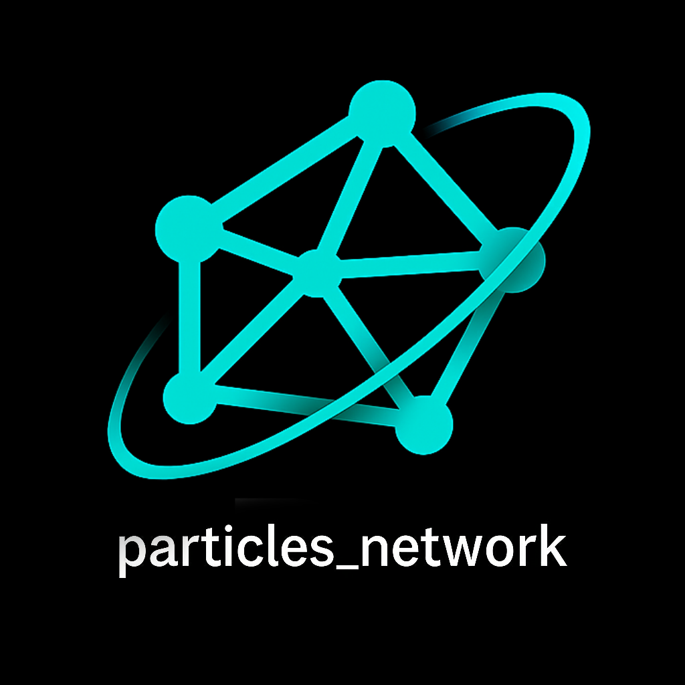

<div align="center">

# Particles Network

**High-performance, physics-driven particle simulation engine for Flutter — meticulously crafted with deep respect for user devices, battery life, and hardware resources.**

<a href="https://github.com/abod8639/Particles_Network">
  
</a>

[]()
[](https://pub.dev/packages/particles_network/score)
[]()

[](https://pub.dev/packages/particles_network)

[](https://pub.dev/packages/particles_network/score)
[](https://pub.dev/packages/particles_network)
[](https://opensource.org/licenses/MIT)
[](https://github.com/abod8639/particles_network)

[](https://codecov.io/gh/abod8639/particles_network)
[](https://pub.dev/packages/particles_network)
[](https://particle-network-example.web.app/)

[Live Demo](https://particle-network-example.web.app/) • [Features](#features) • [Quick Start](#quick-start) • [Installation](#installation) • [Configuration](#configuration-options) • [Examples](#examples) • [Performance & Benchmarks](#performance-benchmarks)

</div>

---

<p align="center">
  <a href="https://github.com/abod8639/Particles_Network"><b>GitHub</b></a> •
  <a href="https://pub.dev/packages/particles_network"><b>Pub.dev</b></a> •
  <a href="https://particle-network-example.web.app"><b>Live Demo</b></a> •
  <a href="#configuration-options"><b>API Reference</b></a>
</p>

> ### Engineering Philosophy: Built with Respect for Hardware & Developers
>
> **Particles Network is built differently.** Designed from the ground up with obsessive attention to detail, every data structure, spatial query, and draw call is engineered with surgical precision to minimize memory allocations, eliminate garbage collection pauses, and deliver silky-smooth 60/120 FPS animations without exhausting your users' device resources.

---

## Table of Contents

- [Features](#features)
- [Demo](#demo)
- [Live Demo](#live-demo)
- [Installation](#installation)
- [Quick Start](#quick-start)
- [Platform Support](#platform-support)
- [Configuration Options](#configuration-options)
  - [Core Widget API (`ParticleNetwork`)](#core-widget-api-particlenetwork)
  - [Particle Features Configuration (`ParticleFeatures`)](#particle-features-configuration-particlefeatures)
  - [Network Features Configuration (`NetworkFeatures`)](#network-features-configuration-networkfeatures)
  - [Touch Features Configuration (`TouchFeatures`)](#touch-features-configuration-touchfeatures)
  - [Network Performance Configuration (`PerformanceFeatures`)](#network-performance-configuration-performancefeatures)
  - [Complex Cluster Optimization (`ComplexConfig`)](#complex-cluster-optimization-complexconfig)
  - [Particle Gravity Configuration (`GravityFeatures`)](#particle-gravity-configuration-gravityfeatures)
  - [Backward Compatibility (1.9.6 Parameters)](#backward-compatibility-196-parameters)
- [Examples](#examples)
- [Architecture & Performance Engineering](#architecture--performance-engineering)
- [Performance Benchmarks](#performance-benchmarks)
  - [Version Comparison: 1.9.6 (Old) vs 1.9.7 (New)](#version-comparison-196-old-vs-197-new)
  - [Key Performance & Architectural Improvements](#key-performance--architectural-improvements)
  - [Test Suites: 1.9.6 vs 1.9.7](#test-suites-196-vs-197)
  - [Detailed Benchmarks & Reproduction Guide](#detailed-benchmarks--reproduction-guide)
- [Troubleshooting](#troubleshooting)
- [FAQ](#faq)
- [Migration Guide](#migration-guide)
- [Contributing](#contributing)
- [License](#license)

---

## Features

- **Physics & Force Engine**
  - **Dual Gravity Modes**: Seamless simulation of directional Global gravity and Point-source (attraction/repulsion) gravity.
  - **Mass-Proportional Dynamics**: Particle mass scales with radius; heavier nodes resist velocity shifts naturally.
  - **Boundary & Viewport Collisions**: Radius-aware edge collision detection (`x < size`, `x > width - size`) ensures particles bounce cleanly on outer edge contact without visual clipping.
  - **Realistic Gesture Dynamics**: Touch attraction, viscous damping, velocity capping, and smooth deceleration recovery.
  - **Trajectory Preservation**: Maintains smooth inertia vectors during deceleration and settling.

- **High-Throughput Rendering & Zero Allocations**
  - **Unified Performance Architecture (`PerformanceFeatures`)**: All line budgets, frame scaling, and cluster throttling grouped into a clean, declarative object with built-in presets (`highPerformance`, `auto`, `complex`, `balanced`).
  - **Dynamic Performance Auto-Boosting (`autoBoost`)**: Real-time engine `FrameTiming` telemetry that actively modulates connection budgets to ensure steady 60/120 FPS.
  - **Indexed Triangle Quads (`LineRenderer.vertices`)**: Submits connections as GPU triangle quads in a single `drawVertices` call per opacity level for a 10x–20x raster speedup.
  - **Cluster Throttling (`ComplexConfig`)**: Prunes redundant connections in dense particle groupings without degrading visual fidelity in sparse areas.
  - **Bounded $O(N)$ Connections (`maxConnectionsPerParticle`)**: Enforces per-node degree limits to eliminate $O(N^2)$ exponential slowdowns in crowded views.
  - **Zero-Allocation Color LUT**: Precomputed 256-level opacity table eliminates per-frame `Color` allocations and Garbage Collection (GC) pauses.
  - **Spatial Partitioning**: High-performance `SortedSpatialGrid` delivers $O(K)$ fixed-radius lookups with 0 steady-state heap allocations and sub-0.1ms builds.
  - **Touch Inactivity Bypass**: Bypasses proximity checks and force routines when no pointer is active.

- **Developer Friendly**
  - Zero external dependencies beyond Flutter SDK.
  - Fully reactive to screen resize and parent layout constraints.
  - Modular, composable feature architecture (`ParticleFeatures`, `NetworkFeatures`, `TouchFeatures`, `PerformanceFeatures`, `ComplexConfig`, `GravityFeatures`).
  - 100% backward compatibility with all Version 1.9.6 parameters.

---

## Demo

<p align="center">
  
</p>

<p align="center">
  <table align="center">
    <tr align="center">
      <td><b>Down Gravity</b></td>
      <td><b>Default Network</b></td>
      <td><b>anti gravity</b></td>
      <td><b>2 Stroke Mode</b></td>
    </tr>
    <tr>
      <td></td>
      <td></td>
      <td></td>
      <td></td>
    </tr>
    <tr align="center">
      <td><b>Black hole</b></td>
      <td><b>Default Network</b></td>
      <td><b>anti gravity</b></td>
      <td><b>small stroke</b></td>
    </tr>
    <tr>
      <td></td>
      <td></td>
      <td></td>
      <td></td>
    </tr>
  </table>
</p>

---

## Live Demo

Experience interactive physics and high frame rates directly in your browser:

<p align="center">
  <a href="https://particle-network-example.web.app">
    
  </a>
</p>

---

## Installation

Add `particles_network` to your `pubspec.yaml`:

```yaml
dependencies:
  particles_network: ^1.9.7
```

Then run:

```bash
flutter pub get
```

---

## Quick Start

```dart
import 'package:material_ui/material_ui.dart';
import 'package:particles_network/particles_network.dart';

void main() => runApp(const MyApp());

class MyApp extends StatelessWidget {
  const MyApp({super.key});

  @override
  Widget build(BuildContext context) {
    return const MaterialApp(
      debugShowCheckedModeBanner: false,
      home: Scaffold(
        backgroundColor: Colors.black,
        body: ParticleNetwork(
          particles: const ParticleFeatures(count: 300),
          network: const NetworkFeatures(
            distance: 80,
            color: Colors.tealAccent,
          ),
          touch: const TouchFeatures(enabled: true),
        ),
      ),
    );
  }
}
```

---

## Platform Support

| Platform    | Support | Graphics Pipeline                      |
| :---------- | :-----: | :------------------------------------- |
| **Android** |  Full   | Hardware Accelerated (Impeller / Skia) |
| **iOS**     |  Full   | Metal Accelerated (Impeller)           |
| **Web**     |  Full   | WebAssembly & CanvasKit (`--wasm`)     |
| **macOS**   |  Full   | Metal Native                           |
| **Windows** |  Full   | DirectX Native                         |
| **Linux**   |  Full   | OpenGL Native                          |

**Requirements:**

- Flutter SDK `>=3.50.0`
- Dart SDK `>=3.12.0 <4.0.0`

---

## Configuration Options

### Core Widget API (`ParticleNetwork`)

The top-level `ParticleNetwork` widget orchestrates simulation physics, spatial indexing, touch interactions, line budgets, and GPU-accelerated rendering:

| Property                  | Type                  | Default                       | Description                                                                                                                 |
| :------------------------ | :-------------------- | :---------------------------- | :-------------------------------------------------------------------------------------------------------------------------- |
| `particles`               | `ParticleFeatures`    | `const ParticleFeatures()`    | Encapsulated particle appearance, count, velocity limits, radius bounds, and fill/stroke mode.                              |
| `network`                 | `NetworkFeatures`     | `const NetworkFeatures()`     | Encapsulated network line settings: drawing toggle, line width, line distance, line color, and GPU rasterization backend.  |
| `touch` / `touchFeatures` | `TouchFeatures`       | `const TouchFeatures()`       | Fine-grained touch physics, highlight color, cursor hover, and gesture configuration.                                       |
| `performance`             | `PerformanceFeatures` | `const PerformanceFeatures()` | Comprehensive rendering optimizations, line budgets, frame scaling, and cluster throttling.                                |
| `gravity`                 | `GravityFeatures?`    | `null`                        | Unified gravity configuration (global directional or point attractor/repeller gravity).                                     |
| `spatialGrid`             | `SortedSpatialGrid?`  | `null`                        | Optional custom spatial partitioning grid instance for neighbor indexing (defaults to internally managed instance).         |

```dart
ParticleNetwork(
  particles: const ParticleFeatures(
    count: 80,
    maxSpeed: 0.8,
    color: Colors.white,
  ),
  network: const NetworkFeatures(
    width: 0.8,
    distance: 120.0,
    color: Color(0xFF00E5FF),
    renderer: LineRenderer.vertices,
  ),
  touch: const TouchFeatures(
    enabled: true,
    hover: true,
  ),
  performance: const PerformanceFeatures(
    maxLinesPerFrame: 15000,
    frameRateIndependent: true,
  ),
  gravity: const GravityFeatures.global(
    strength: 0.15,
    direction: Offset(0, 1),
  ),
)
```

---

### Particle Features Configuration (`ParticleFeatures`)

Encapsulate particle cloud density, speed ceilings, radius limits, colors, and fill styles with `ParticleFeatures`:

| Property   | Type     | Default             | Description                                                                 |
| :--------- | :------- | :------------------ | :-------------------------------------------------------------------------- |
| `count`    | `int`    | `60`                | Number of particles simulated and rendered on screen.                       |
| `maxSpeed` | `double` | `0.5`               | Maximum base wandering velocity ceiling (pixels per 60Hz reference frame).  |
| `maxSize`  | `double` | `1.5`               | Maximum particle radius in logical pixels.                                  |
| `color`    | `Color`  | `Color(0xFFFFFFFF)` | Solid particle disc or stroked ring color.                                  |
| `fill`     | `bool`   | `true`              | `true` for solid filled discs, `false` for stroked rings.                   |

#### Built-in Presets:
- `ParticleFeatures.subtle()`: 35 particles, 0.3 maxSpeed, 1.2 maxSize — gentle background.
- `ParticleFeatures.dense()`: 120 particles, 0.8 maxSpeed, 2.0 maxSize — rich energetic plexus.
- `ParticleFeatures.cosmic()`: 90 particles, 1.2 maxSpeed, 2.5 maxSize — high-velocity hero section.

```dart
// 1. Custom particle styling
ParticleNetwork(
  particles: const ParticleFeatures(
    count: 80,
    maxSpeed: 0.8,
    maxSize: 2.0,
    color: Colors.white,
    fill: true,
  ),
)

// 2. Or using built-in presets:
// particles: ParticleFeatures.subtle() // Gentle quiet background
// particles: ParticleFeatures.dense()  // Rich energetic plexus
// particles: ParticleFeatures.cosmic() // Dynamic hero section
```

---

### Network Features Configuration (`NetworkFeatures`)

Encapsulate connection line visibility, stroke dimensions, distance thresholds, colors, and GPU rasterization backend with `NetworkFeatures`:

| Property   | Type           | Default                 | Description                                                                                     |
| :--------- | :------------- | :---------------------- | :---------------------------------------------------------------------------------------------- |
| `enabled`  | `bool`         | `true`                  | Whether to draw connection lines between particles in proximity.                                |
| `width`    | `double`       | `0.5`                   | Stroke width of connection lines in logical pixels.                                             |
| `distance` | `double`       | `100.0`                 | Connection radius threshold between particles.                                                  |
| `color`    | `Color`        | `Color(0xFF64FFB4)`     | Base color of connection lines.                                                                 |
| `renderer` | `LineRenderer` | `LineRenderer.vertices` | GPU rasterization backend (`LineRenderer.vertices` for GPU batching or `LineRenderer.stroke`). |

> [!NOTE]
> For backward compatibility, `drawNetwork`, `lineWidth`, `lineDistance`, `lineColor`, and `lineRenderer` remain supported as direct parameter aliases.

```dart
ParticleNetwork(
  network: const NetworkFeatures(
    enabled: true,
    width: 0.8,
    distance: 120.0,
    color: Color(0xFF64FFB4),
    renderer: LineRenderer.vertices, // 10x–20x GPU raster acceleration with indexed triangle quads
  ),
)
```

---

### Touch Features Configuration (`TouchFeatures`)

Fine-tune interaction dynamics, cursor hover, and touch styling with `TouchFeatures`:

| Property   | Type        | Default          | Description                                                                                            |
| :--------- | :---------- | :--------------- | :----------------------------------------------------------------------------------------------------- |
| `type`     | `TouchType` | `TouchType.pull` | Interaction physics mode: `TouchType.pull` (attracts, default) or `TouchType.push` (repels/scatters). |
| `show`     | `bool`      | `true`           | Enables or disables rendering touch connecting lines while keeping touch physics active.               |
| `enabled`  | `bool`      | `true`           | Enables touch and gesture interactions.                                                                |
| `color`    | `Color`     | `Colors.amber`   | Highlight color for particles near touch position.                                                     |
| `force`    | `double`    | `0.42`           | Attraction or repulsion strength toward the touch point.                                               |
| `speed`    | `double`    | `0.42`           | Recovery rate back to cruising speed after touch release.                                              |
| `damping`  | `double`    | `0.985`          | Drag coefficient within the touch field.                                                               |
| `maxSpeed` | `double`    | `5.5`            | Strict speed ceiling during touch attraction.                                                          |
| `distance` | `double?`   | `null`           | Touch interaction radius (defaults to widget/network `distance`).                                      |
| `hover`    | `bool`      | `false`          | Enables cursor tracking on desktop and web without requiring a touch/click gesture.                    |

> [!NOTE]
> - `type` accepts `TouchType.pull` (default - attracts particles towards the cursor, preserving 100% 1.9.6 compatibility) or `TouchType.push` (repels particles away from the cursor).
> - `maxTouchSpeed` and `lineDistance` are deprecated compatibility aliases for `maxSpeed` and `distance` respectively.
> - `pullForce` and `decayRate` are deprecated compatibility aliases for `force` and `speed` respectively.
> - `hover` replaces the older `hoverEffect` parameter inside `TouchFeatures`.

```dart
ParticleNetwork(
  touch: const TouchFeatures(
    type: TouchType.push, // TouchType.push (repels) or TouchType.pull (attracts)
    enabled: true,
    hover: true, // Enables cursor tracking on desktop and web
    color: Colors.amber,
    force: 0.5,
    damping: 0.98,
    maxSpeed: 6.0,
    speed: 0.42,
  ),
)
```

---

### Network Performance Configuration (`PerformanceFeatures`)

Encapsulates all line budgets, GPU acceleration, frame rate adaptation, and cluster throttling into `PerformanceFeatures`:

| Property                    | Type            | Default                 | Description                                                                                                                    |
| :-------------------------- | :-------------- | :---------------------- | :----------------------------------------------------------------------------------------------------------------------------- |
| `maxConnectionsPerParticle` | `int?`          | `null`                  | Limits lines per particle, bounding edge complexity to $O(N)$ instead of $O(N^2)$.                                            |
| `maxLinesPerFrame`          | `int?`          | `null`                  | Dynamic line budget: automatically contracts connection radius so line count stays flat at heavy density (~2,000 for strokes, ~15,000 for vertices). |
| `frameRateIndependent`      | `bool`          | `false`                 | Integrates motion over elapsed delta-time so particle speed is identical at 60/90/120 Hz displays and smooth through dropped frames. |
| `complex`                   | `ComplexConfig` | `const ComplexConfig()` | Encapsulates cluster density pruning and candidate line throttling to eliminate clutter in congested areas.                    |
| `cappedDistanceFactor`      | `double`        | `0.75`                  | Proximity threshold ratio applied when `maxConnectionsPerParticle` is active, avoiding edge flickering and distant lines.      |
| `antiAlias`                 | `bool`          | `true`                  | Smooth anti-aliased edge rendering for particle circles and connection lines.                                                 |
| `spatialCellMultiplier`     | `double?`       | `null`                  | Optional custom grid cell size multiplier for spatial partitioning calculations.                                               |
| `autoBoost`                 | `bool`          | `false`                 | Real-time dynamic performance auto-boosting that measures engine `FrameTiming` to scale connection limits on the fly.          |

#### Performance Presets & Usage:

```dart
// 1. High-Performance Preset: tuned for extreme particle counts (1,000+ to 20,000)
const ParticleNetwork(
  particles: ParticleFeatures(count: 2000),
  performance: PerformanceFeatures.highPerformance(),
)

// 2. Auto-Adaptive Preset: real-time telemetry auto-boost targeting locked 60/120 FPS
const ParticleNetwork(
  particles: ParticleFeatures(count: 500),
  performance: PerformanceFeatures.auto(),
)

// 3. Balanced Preset: rich visual density with sensible caps (6 connections/node, 8k lines budget)
const ParticleNetwork(
  particles: ParticleFeatures(count: 200),
  performance: PerformanceFeatures.balanced(),
)

// 4. Custom Performance Configuration
const ParticleNetwork(
  particles: ParticleFeatures(count: 1000),
  performance: PerformanceFeatures(
    maxConnectionsPerParticle: 4,
    maxLinesPerFrame: 15000,
    frameRateIndependent: true,
    autoBoost: true,
  ),
)
```

---

### Complex Cluster Optimization (`ComplexConfig`)

The `ComplexConfig` (or `ComplexFeatures`) class fine-tunes cluster throttling and connection pruning in dense particle groupings, preventing visual clutter and GPU fill-rate degradation:

| Property        | Type      | Default | Description                                                                                                    |
| :-------------- | :-------- | :------ | :------------------------------------------------------------------------------------------------------------- |
| `enabled`       | `bool`    | `false` | Whether cluster throttling optimization is active.                                                             |
| `ratio`         | `double?` | `null`  | Fraction of candidate connection lines pruned in dense clusters (`0.0` to `1.0`, e.g. `0.4` eliminates 40%).     |
| `maxLines`      | `int?`    | `null`  | Maximum connection lines allowed per particle in a dense cluster (e.g. `3` lines).                             |
| `densityFactor` | `double?` | `null`  | Proximity distance multiplier factor used to detect whether a particle is inside a dense cluster (e.g. `0.60`). |

#### Built-in Presets:
- `ComplexConfig()`: Disabled by default.
- `ComplexConfig.auto()`: Automatically enables cluster throttling with recommended bounds (`maxLines: 3`, `densityFactor: 0.60`).
- `ComplexConfig.disabled()`: Explicitly disables cluster throttling with all overrides cleared.

```dart
// 1. Custom cluster optimization
const ParticleNetwork(
  performance: PerformanceFeatures(
    complex: ComplexConfig(
      enabled: true,
      ratio: 0.4, // Prune 40% of candidate lines in congested clusters
      maxLines: 3, // Max lines per particle inside dense areas
      densityFactor: 0.60, // Proximity factor for cluster detection
    ),
  ),
)

// 2. Or using auto cluster preset
const ParticleNetwork(
  performance: PerformanceFeatures(
    complex: ComplexConfig.auto(),
  ),
)
```

---

### Particle Gravity Configuration (`GravityFeatures`)

Configure directional forces, radial attractors, and repulsion fields with `GravityFeatures`:

| Property    | Type          | Default              | Description                                                                              |
| :---------- | :------------ | :------------------- | :--------------------------------------------------------------------------------------- |
| `type`      | `GravityType` | `GravityType.none`   | Gravity behavior mode: `GravityType.none`, `GravityType.global`, or `GravityType.point`. |
| `strength`  | `double`      | `0.1`                | Force intensity. For point gravity: positive values attract, negative values repel.     |
| `direction` | `Offset`      | `const Offset(0, 1)` | Direction vector for `GravityType.global` (e.g. `Offset(0, 1)` for downward fall).       |
| `center`    | `Offset?`     | `null`               | Center point for `GravityType.point` (defaults to canvas center when `null`).            |

> [!NOTE]
> - `gravityType`, `gravityStrength`, `gravityDirection`, and `gravityCenter` are deprecated compatibility aliases scheduled for removal in v2.0.0. Use `gravity: GravityFeatures(...)` instead.
> - Particle **mass** is calculated automatically from radius — larger particles naturally have greater inertia and resist velocity changes more than smaller ones.

#### Built-in Presets & Usage:

```dart
// 1. Global Directional Gravity: uniform downward fall (e.g. falling snow, rain)
const ParticleNetwork(
  gravity: GravityFeatures.global(
    strength: 0.3,
    direction: Offset(0, 1), // Downward fall
  ),
)

// 2. Point Gravity Attractor: black hole pulling particles towards center
const ParticleNetwork(
  gravity: GravityFeatures.point(
    strength: 0.5, // Positive = Attraction
  ),
)

// 3. Point Gravity Repeller: force field pushing particles away from center
const ParticleNetwork(
  gravity: GravityFeatures.point(
    strength: -1.2, // Negative = Repulsion
  ),
)

// 4. Custom Gravity Configuration
const ParticleNetwork(
  gravity: GravityFeatures(
    type: GravityType.global,
    strength: 0.2,
    direction: Offset(1, 0), // Horizontal wind drift
  ),
)
```

---

### Backward Compatibility (1.9.6 Parameters)

All parameters from Version 1.9.6 remain **100% backward compatible** and continue to function seamlessly without breaking changes:

| Legacy Property             | Modern Replacement Mapping                                         | Status in 1.9.7   |
| :-------------------------- | :----------------------------------------------------------------- | :---------------- |
| `particleCount`             | `particles: ParticleFeatures(count: ...)`                          | Deprecated (v2.0) |
| `maxSpeed`                  | `particles: ParticleFeatures(maxSpeed: ...)`                       | Deprecated (v2.0) |
| `maxSize`                   | `particles: ParticleFeatures(maxSize: ...)`                        | Deprecated (v2.0) |
| `particleColor`             | `particles: ParticleFeatures(color: ...)`                          | Deprecated (v2.0) |
| `fill`                      | `particles: ParticleFeatures(fill: ...)`                           | Deprecated (v2.0) |
| `drawNetwork`               | `network: NetworkFeatures(enabled: ...)`                           | Deprecated (v2.0) |
| `lineWidth`                 | `network: NetworkFeatures(width: ...)`                             | Deprecated (v2.0) |
| `lineDistance`              | `network: NetworkFeatures(distance: ...)`                          | Deprecated (v2.0) |
| `lineColor`                 | `network: NetworkFeatures(color: ...)`                             | Deprecated (v2.0) |
| `networkFeatures`           | `network: NetworkFeatures(...)`                                    | Deprecated (v2.0) |
| `touchActivation`           | `touch: TouchFeatures(enabled: ...)`                               | Deprecated (v2.0) |
| `touchColor`                | `touch: TouchFeatures(color: ...)`                                 | Deprecated (v2.0) |
| `hoverEffect`               | `touch: TouchFeatures(hover: ...)`                                 | Deprecated (v2.0) |
| `isComplex`                 | `performance: PerformanceFeatures(complex: ComplexConfig.auto())`  | Deprecated (v2.0) |
| `maxConnectionsPerParticle` | `performance: PerformanceFeatures(maxConnectionsPerParticle: ...)` | Deprecated (v2.0) |
| `adaptiveDensity`           | `performance: PerformanceFeatures(complex: ComplexConfig.auto())`  | Deprecated (v2.0) |
| `fastLineRendering`         | `network: NetworkFeatures(renderer: LineRenderer.vertices)`        | Deprecated (v2.0) |
| `useVerticesRendering`      | `network: NetworkFeatures(renderer: LineRenderer.vertices)`        | Deprecated (v2.0) |
| `enableAdaptivePerformance` | `performance: PerformanceFeatures(autoBoost: ...)`                  | Deprecated (v2.0) |
| `gravityType`               | `gravity: GravityFeatures(type: ...)`                              | Deprecated (v2.0) |
| `gravityStrength`           | `gravity: GravityFeatures(strength: ...)`                          | Deprecated (v2.0) |
| `gravityDirection`          | `gravity: GravityFeatures(direction: ...)`                         | Deprecated (v2.0) |
| `gravityCenter`             | `gravity: GravityFeatures(center: ...)`                            | Deprecated (v2.0) |

```dart
// Legacy 1.9.6 Syntax (still 100% supported):
const ParticleNetwork(
  particleCount: 150,
  maxSpeed: 0.8,
  lineDistance: 100.0,
  lineWidth: 0.8,
  particleColor: Colors.white,
  lineColor: Color(0xFF64FFB4),
  touchActivation: true,
  hoverEffect: true,
)

// Recommended 1.9.7 Modern Equivalent:
const ParticleNetwork(
  particles: ParticleFeatures(
    count: 150,
    maxSpeed: 0.8,
    color: Colors.white,
  ),
  network: NetworkFeatures(
    distance: 100.0,
    width: 0.8,
    color: Color(0xFF64FFB4),
  ),
  touch: TouchFeatures(
    enabled: true,
    hover: true,
  ),
)
```

---

## Examples

### 1. Background Visual for Landing Pages

```dart
import 'package:material_ui/material_ui.dart';
import 'package:particles_network/particles_network.dart';

class LandingBackgroundPage extends StatelessWidget {
  const LandingBackgroundPage({super.key});

  @override
  Widget build(BuildContext context) {
    return Scaffold(
      backgroundColor: const Color(0xFF0F172A),
      body: Stack(
        children: [
          const Positioned.fill(
            child: ParticleNetwork(
              particles: ParticleFeatures(
                count: 75,
                maxSpeed: 0.6,
                color: Color(0xFF38BDF8),
              ),
              network: NetworkFeatures(
                color: Color(0xFF0284C7),
              ),
              touch: TouchFeatures(enabled: true),
            ),
          ),
          Center(
            child: Text(
              'Welcome',
              style: Theme.of(context).textTheme.headlineLarge?.copyWith(
                    color: Colors.white,
                    fontWeight: FontWeight.bold,
                  ),
            ),
          ),
        ],
      ),
    );
  }
}
```

### 2. Black Hole Particle Siphon

```dart
const ParticleNetwork(
  particles: ParticleFeatures(
    count: 160,
    color: Colors.deepPurpleAccent,
  ),
  network: NetworkFeatures(
    color: Colors.purple,
  ),
  gravity: GravityFeatures.point(
    strength: 1.5, // Positive value attracts toward center
  ),
)
```


---

## Architecture & Performance Engineering

### 1. Batched Flat-Buffer Line Rendering (`fastLineRendering`)

Instead of issuing individual `canvas.drawLine` commands per connection (which induces CPU-GPU context switches), `fastLineRendering: true` aggregates segment pairs into pre-allocated `Float32List` buckets and draws them with batched `canvas.drawRawPoints(PointMode.lines, ...)` calls.

### 2. Triangle Line Renderer (`LineRenderer.vertices`)

Engine strokes are tessellated one segment at a time. With `LineRenderer.vertices`, the painter instead expands each connection into an indexed quad (4 vertices, two triangles) `lineWidth` thick, and submits each opacity level with one `canvas.drawVertices` call. The connections and their fades are the same as with strokes; only the GPU path changes.

### 3. Cell-Sorted SoA Neighbour Search (`SortedSpatialGrid`)

Each frame, the batched and `fastLineRendering` paths counting-sort the visible particles by grid cell into flat `Float64List` coordinate arrays. Because cells are stored row-major, the candidates for a particle are just two contiguous memory ranges: the rest of its own cell plus the east cell, then the south-west, south and south-east cells. The pair loop therefore scans sequential typed memory instead of following per-cell linked lists and dereferencing `Particle` objects. The cell size is $\max(r, \sqrt{A / (4N)})$ with a floor down to 4.0 px when budgeted and capped at $\le 4N$ and 250,000 total cells. This ensures cells shrink appropriately when budgeting reduces $r$, eliminating up to 97% of wasted distance checks in clustered scenes while avoiding cell-count blowup on 4K displays.

### 4. Line Budget (`maxLinesPerFrame`)

The number of connections grows as $\frac{N^2 \pi r^2}{2A}$, so it grows quadratically with particle count, and on real devices line rasterization dominates frame time. Given a budget $B$, the painter picks $r = \sqrt{\frac{2AB}{\pi N^2}}$ and corrects it every frame from the measured line count, which handles clustered particles. Frame cost then stays flat however many particles you add.

### 5. Bounded $O(N)$ Degree Limiting (`maxConnectionsPerParticle`)

Unbounded proximity checks in dense meshes produce up to $\frac{N(N-1)}{2}$ edges ($O(N^2)$). Capping connections per particle (e.g. `maxConnectionsPerParticle: 4`) provides a predictable $O(N)$ complexity ceiling, maintaining high frame rates even with 1,000+ particles.

### 6. Spatial Partitioning Architecture (`SortedSpatialGrid`)

The engine leverages `SortedSpatialGrid` for spatial acceleration, counting-sorting particles into sequential Structure-of-Arrays (SoA) memory buffers with zero steady-state heap allocations:

```dart
// Direct SortedSpatialGrid usage (automatically managed by ParticleNetwork)
final grid = SortedSpatialGrid();
grid.build(particles, visibleIndices, width, height, radius);

// Zero-allocation neighbor query
grid.queryRadius(touchX, touchY, radius, (idx, px, py, distSq) {
  // Process candidate particle index
});
```

> **Note on Legacy QuadTree:** Legacy spatial classes (`CompressedQuadTree`, `StandardQuadTree`, and `SpatialGrid`) are deprecated and scheduled for removal in v2.0.0. `SortedSpatialGrid` outperforms them with sub-0.1ms build times and sustained 60+ FPS at 5,000 particles.

### 7. Zero-Allocation Color LUT (`_lineColorLut`)

Opacity alpha gradients for connection lines are looked up in a precomputed 256-entry table using pre-calculated inverse distances ($255.0 / \text{lineDistance}$). This completely eliminates runtime `Color.withAlpha` allocations and GC pauses during the render cycle.

### 8. Hardware Stewardship & Battery Conservation

To ensure animations run smoothly without punishing consumer hardware:

- **Zero GC Pressure**: The hot rendering loop avoids transient object allocations, preventing Dart Garbage Collector pauses that cause micro-stutters.
- **Passive Power Saving**: Proximity and gesture calculations completely shut down when the screen is idle, letting CPU cores rest.
- **Proactive Thermal & Battery Protection**: `enableAdaptivePerformance` dynamically throttles connection workloads during rendering spikes to avoid device overheating and excessive battery drain.

### 9. Headless Simulation & Advanced Extensibility

Beyond the declarative `ParticleNetwork` widget, the core physics and rendering pipelines are decoupled and directly usable:

- **`ParticleSimulation`**: A headless, framework-agnostic simulation engine for driving physics ticks, managing particle lists, and querying spatial partitions outside the widget tree.
- **`TrajectoryBuffer`**: Computes and pre-allocates future deterministic particle positions across $N$ frames, ideal for path forecasting or server-side synchronization.
- **`GridTuning`**: An immutable tuning model passed to `SortedSpatialGrid` to customize density scaling ($k$), safety floors, and display-adaptive bounds fitting.
- **`IParticleFactory` / `DefaultParticleFactory`**: Pluggable particle generation factories for customizing particle attributes (sizes, velocities, distributions) upon creation.

---

## Performance Benchmarks

### Version Comparison: 1.9.6 (Old) vs 1.9.7 (New)

The table below contrasts the real-world performance differences between **Version 1.9.6 (Old)** and **Version 1.9.7 (New)**, measured under identical workloads on physical hardware (**Samsung Galaxy S10**, SM-G973U, Qualcomm Snapdragon 855 / Adreno 640 GPU, Flutter Impeller backend, Profile AOT mode, Full-Screen).

> **Upgrade Impact Breakdown:**
> - **Default (Drop-in) Upgrade**: Upgrading from 1.9.6 to 1.9.7 automatically activates `SortedSpatialGrid` with **0 steady-state heap allocations** (100% GC pressure eliminated) and **32%–45% lower CPU paint times** without changing any code.
> - **Maximum Performance Architecture**: Enabling `LineRenderer.vertices` and `maxLinesPerFrame` (e.g. via `performance: PerformanceFeatures.highPerformance()`) unlocks a **10x–20x GPU raster speedup**, eliminating jank and scaling to 5,000–20,000 particles at smooth 60 FPS.

| Scenario / Workload | Old Version (1.9.6) | New Version (1.9.7) | Performance Gain / Impact |
| :------------------ | :------------------ | :------------------ | :----------------|
| **500 Particles**<br>*(Default `lineDistance: 100`)* | **15.0 – 15.4 FPS**<br>• Raster p50: 61.0 – 68.1 ms<br>• Jank Ratio: 1.0 (100% dropped frames)<br>• Pipeline: Stroke lines, QuadTree | **63.8 FPS**<br>• Raster p50: **4.88 ms** (p90: 6.0 ms)<br>• Jank Ratio: **0.0 (Zero jank)**<br>• Pipeline: `LineRenderer.vertices` + `SortedSpatialGrid` | **+314% FPS** (4.1x boost)<br>**12.5x faster rasterization**<br>Jank eliminated |
| **1,000 Particles**<br>*(Default connections enabled)* | **4.2 FPS**<br>• Raster p50: 248.1 – 253.1 ms<br>• Jank Ratio: 1.0 (Unusable slideshow)<br>• Pipeline: Unbudgeted strokes | **41.8 FPS**<br>• Raster p50: **12.38 ms** (p90: 15.9 ms)<br>• Jank Ratio: 0.47<br>• Pipeline: Indexed triangle quads | **10x FPS increase**<br>**20x faster rasterization** (248 ms → 12.4 ms) |
| **2,000 Particles**<br>*(Constrained degree: `maxConnections: 5`)* | **23.8 – 26.0 FPS**<br>• Raster p50: 39.6 – 43.3 ms<br>• Jank Ratio: 1.0<br>• Pipeline: Stroked edges | **62.4 FPS**<br>• Raster p50: **5.60 ms** (p90: 6.5 ms)<br>• Jank Ratio: **0.0 (Rock solid)**<br>• Pipeline: Triangle quads | **+140% FPS** (2.4x boost)<br>**7x faster rasterization**<br>Sustains locked 60+ FPS |
| **2,000 Particles**<br>*(Unbudgeted connections)* | **0.6 FPS**<br>• Raster p50: 2,096.7 ms (2.1s per frame!)<br>• Load: ~229,000 lines generated<br>• Fatal GPU lockup / freeze | **62.0 FPS** *(with line budget)*<br>• Raster p50: **8.07 ms** (p90: 9.6 ms)<br>• Jank Ratio: 0.02 | **103x FPS boost**<br>**260x faster rasterization**<br>Prevents device freeze and GPU OOM |
| **5,000 Particles**<br>*(Connection network)* | **Unviable in 1.9.6**<br>• No line budget ($O(N^2)$ edge explosion)<br>• >1.4 million lines, GPU crash | **64.0 FPS** *(with 15k budget + vertices)*<br>• Raster p50: **8.42 ms** (p90: 9.4 ms)<br>• Jank Ratio: **0.0** *(vs 9.6 FPS with strokes)* | **Brand-new capability**<br>**13x faster rasterization**<br>Zero jank at 5k particles |
| **10,000 Particles**<br>*(Connection network)* | **Unviable in 1.9.6**<br>• Device lockup / OOM crash | **60.2 FPS** *(with 15k budget + vertices)*<br>• Raster p50: **7.99 ms**<br>• Pipeline: SoA Grid + Vertices | **Brand-new capability**<br>Sustains 60 FPS on 10,000 nodes |
| **20,000 Particles**<br>*(Connection network)* | **Unviable in 1.9.6**<br>• Device lockup / OOM crash | **61.8 – 64.5 FPS** *(with 15k budget)*<br>• Raster p50: **8.0 ms**<br>• UI build: 5.1–5.4 ms | **Brand-new capability**<br>Sustains 60+ FPS on 20k nodes |
| **500 Particles (Adaptive Mode)**<br>*(`enableAdaptivePerformance`)* | **50.0 – 58.4 FPS**<br>• Raster p90: 18.9 – 22.8 ms<br>• Mechanism: Timer tick heuristic (60Hz fixed) | **63.6 FPS**<br>• Raster p50: **14.0 ms**, p90: **15.7 ms**<br>• Mechanism: Engine `FrameTiming` telemetry | **Accurate hardware feedback**<br>Adapts to native 60/90/120 Hz displays |
| **Spatial Grid Build & Query**<br>*(CPU Time per Frame)* | **High GC Pressure & Pointer Chasing**<br>• Legacy QuadTree node allocations<br>• Cache misses on linked lists | **Sub-0.1 ms build time**<br>• **0 steady-state heap allocations**<br>• 32%–45% lower CPU paint times | **Zero GC pressure**<br>Cache-friendly contiguous memory |
| **Physics on High-Refresh Screens**<br>*(90 Hz / 120 Hz Displays)* | **Frame-rate dependent**<br>• Ran 1.5x–2x too fast on 90/120 Hz<br>• Motion lagged during frame drops | **Frame-rate independent**<br>• Delta-time integration (`frameRateIndependent`)<br>• Consistent speed across 60/90/120 Hz | **Uniform physics trajectory**<br>No velocity warp on high refresh rates |

### Key Performance & Architectural Improvements

The performance leap between 1.9.6 and 1.9.7 is driven by six targeted architectural innovations:

1. **Indexed Triangle Quads (`LineRenderer.vertices`) vs. Engine Strokes**
   - **Old Version (1.9.6)**: Rendered lines as individual canvas stroke segments (`LineRenderer.stroke`). Each line incurred GPU stroke tessellation overhead (~7 µs per line on mobile GPUs), quickly saturating the rasterizer when lines exceeded a few hundred.
   - **New Version (1.9.7)**: Replaces stroke primitives with indexed quads via `LineRenderer.vertices` and `LineVertexBatch`. Each segment is expanded into 4 vertices with 6 shared `Uint16` indices (no per-vertex color overhead), cutting vertex payload from 96 to 44 bytes per line. A single batched `canvas.drawVertices` call is issued per opacity level, delivering **10x–12x GPU raster acceleration**.

2. **Structure-of-Arrays Spatial Grid (`SortedSpatialGrid`) vs. Recursive QuadTree**
   - **Old Version (1.9.6)**: Relied on tree-based spatial structures (`CompressedQuadTree`, `StandardQuadTree`, and `SpatialGrid`). Every frame required recursive tree subdivision, heap-allocated wrapper objects (`QuadTreeParticle`), and chasing pointers across memory, creating cache misses and garbage collection pauses.
   - **New Version (1.9.7)**: Replaces trees with `SortedSpatialGrid`, which counting-sorts particles into contiguous `Float64List` memory arrays. Candidate neighbor queries scan sequential memory ranges instead of following linked lists:
     - 20,000 particles (15k lines): CPU paint time dropped from **9.33 ms → 5.1–5.4 ms** (vertices, 45% reduction) and **6.36 ms → 4.3–4.4 ms** (strokes, 32% reduction).
     - 10,000 particles: CPU paint time dropped from **4.56 ms → 3.4–3.7 ms** (25% reduction).
     - 1,000 particles (48k lines): CPU paint time dropped from **7.60 ms → 5.2–6.1 ms**.
     - Steady-state heap allocations: **0 bytes (100% GC pressure eliminated)**.

3. **Dynamic Line Budgeting (`maxLinesPerFrame`) vs. $O(N^2)$ Edge Explosion**
   - **Old Version (1.9.6)**: Proximity connections scaled quadratically ($O(N^2)$). Without manual caps, high particle counts generated hundreds of thousands of lines (e.g., 2,000 particles produced ~229,000 lines), causing catastrophic GPU stalls (0.6 FPS / 2,096 ms raster latency) and freezing the device.
   - **New Version (1.9.7)**: Introduces `maxLinesPerFrame`. The engine dynamically modulates the effective connection radius $r = \sqrt{\frac{2AB}{\pi N^2}}$ with continuous closed-loop feedback for clustered particles. Frame cost remains flat regardless of particle count—allowing 5,000, 10,000, or 20,000 particles to run at a consistent 60 FPS without crashing.

4. **Engine FrameTiming Adaptivity vs. UI Tick Heuristics**
   - **Old Version (1.9.6)**: `enableAdaptivePerformance` evaluated elapsed tick intervals on the UI thread against a hardcoded 16.67 ms (60 Hz) window. It was blind to GPU raster thread lag and unable to adapt to high-refresh-rate displays.
   - **New Version (1.9.7)**: Taps into Flutter engine telemetry via `FrameTiming` callbacks (`platformDispatcher.onReportTimings`), observing both UI build and GPU raster bottlenecks. It targets the device's true display refresh rate (60, 90, or 120 Hz) and dynamically throttles density to keep frame times within the native display budget.

5. **Frame-Rate Independent Physics (`frameRateIndependent`)**
   - **Old Version (1.9.6)**: Particles updated position by adding velocity per frame ($x += v_x$). As a result, particles moved twice as fast on 120 Hz displays compared to 60 Hz devices, and slowed to a crawl during dropped frames.
   - **New Version (1.9.7)**: Physics are integrated over actual elapsed delta time normalized to a 60 Hz reference. Motion velocity remains identical on 60 Hz, 90 Hz, and 120 Hz displays and stays buttery-smooth through dropped frames.

6. **Unified API Ergonomics (`PerformanceFeatures`)**
   - **Old Version (1.9.6)**: Performance options were scattered as standalone constructor arguments (`fastLineRendering`, `maxConnectionsPerParticle`, `adaptiveDensity`, `enableAdaptivePerformance`, `isComplex`).
   - **New Version (1.9.7)**: Consolidated into a declarative, strongly-typed `PerformanceFeatures` configuration with pre-tuned factory constructors (`PerformanceFeatures.highPerformance()`, `PerformanceFeatures.auto()`).

The +210 extra tests in version 1.9.7 cover `SortedSpatialGrid` SoA sorting and neighbor accuracy, dynamic line budgeting, frame-rate independent physics, boundary collision radius offsets, the indexed vertices renderer (including pixel-exact comparison against strokes), worst-case spatial clustering, and adaptive frame telemetry.

### Detailed Benchmarks & Reproduction Guide

For full physical hardware telemetry, raster latency distributions ($p50/p90/p99$), microbenchmarks, and automated reproduction scripts using `flutter drive`, see the dedicated **[BENCHMARKS.md](BENCHMARKS.md)** guide.

---

## Troubleshooting

| Symptom                                    | Likely Cause                  | Solution                                                                                                                                                                                                   |
| :----------------------------------------- | :---------------------------- | :--------------------------------------------------------------------------------------------------------------------------------------------------------------------------------------------------------- |
| **Particles not visible**                  | Low contrast with background  | Set contrasting `particleColor` (e.g. `Colors.white` on dark backgrounds).                                                                                                                                 |
| **Touch does not respond**                 | `touchActivation` disabled    | Ensure `touchActivation: true` and that parent widgets do not block gestures.                                                                                                                              |
| **Frame drops on low-end hardware**        | Too many connections          | Use `performance: PerformanceFeatures.highPerformance()`, set a line budget (`maxLinesPerFrame: 2000` with strokes, `15000` with vertices), or set `maxConnectionsPerParticle: 3`. |
| **Particles move faster on 120 Hz phones** | Speed is per frame by default | Enable `frameRateIndependent: true` in `PerformanceFeatures`.                                                                                                                         |
| **Web stutter**                            | HTML/Canvas renderer          | Build web apps with CanvasKit / Wasm: `flutter build web --wasm`.                                                                                                                                          |

---

## FAQ

### How do I configure particle count per device?

Pass values conditionally based on viewport width or screen size:

```dart
final count = MediaQuery.sizeOf(context).width < 600 ? 50 : 150;
ParticleNetwork(key: ValueKey(count), particleCount: count)
```

### Can I place other widgets above the network?

Yes. Place `ParticleNetwork` inside a `Stack` as the first child, and layer your interactive UI on top.

### Does `ParticleNetwork` stop animating when offscreen?

The animation loop uses Flutter's `TickerProvider`, which automatically pauses when the host route or modal is obscured or disposed.

---

## Migration Guide

### Migrating to 1.9.7

Version 1.9.7 introduces a modular, declarative configuration architecture while ensuring **100% backward compatibility** with all existing 1.9.6 code:

1. **Modular Configuration Objects**:
   - `particles`: Consolidated from `particleCount`, `maxSpeed`, `maxSize`, `particleColor`, and `fill` into `ParticleFeatures`.
   - `network`: Consolidated from `drawNetwork`, `lineWidth`, `lineDistance`, and `lineColor` into `NetworkFeatures(enabled, width, distance, color, renderer)`.
   - `touch`: Consolidated from `touchActivation`, `touchColor`, `pullForce`, `decayRate`, and `hoverEffect` into `TouchFeatures(enabled, color, force, speed, hover, ...)`.
   - `performance`: Grouped line budgeting, delta-time physics, and cluster throttling into `PerformanceFeatures(complex: ComplexConfig.auto(), ...)`.
   - `gravity`: Unified separate `gravityType`, `gravityStrength`, `gravityDirection`, and `gravityCenter` into `GravityFeatures`.

2. **Touch Features Modernization**:
   - `maxSpeed` replaces `maxTouchSpeed` inside `TouchFeatures`.
   - `distance` replaces `lineDistance` inside `TouchFeatures`.
   - `hover` replaces the legacy `hoverEffect` inside `TouchFeatures`.
   - `touchActivation` is renamed to `enabled`.
   - `touchColor` is renamed to `color`.
   - `pullForce` and `decayRate` are renamed to `force` and `speed`.

3. **Complex Cluster Optimization**:
   - Dense cluster connection pruning is encapsulated in `ComplexConfig` (or `ComplexFeatures`) via `performance: PerformanceFeatures(complex: ComplexConfig.auto())`.

### Recommended 1.9.7 Syntax

```dart
ParticleNetwork(
  particles: const ParticleFeatures(
    count: 300,
    maxSpeed: 0.8,
    maxSize: 2.0,
    color: Colors.white,
    fill: true,
  ),
  network: const NetworkFeatures(
    width: 0.8,
    distance: 100.0,
    color: Color(0xFF64FFB4),
    renderer: LineRenderer.vertices, // 10x–20x GPU raster acceleration
  ),
  touch: const TouchFeatures(
    enabled: true,
    hover: true,
    force: 0.42,
    speed: 0.42,
  ),
  performance: const PerformanceFeatures(
    maxLinesPerFrame: 15000,
    frameRateIndependent: true,
    complex: ComplexConfig.auto(),
  ),
)
```

### 1.9.6 Backward Compatibility Guarantee

All Version 1.9.6 code continues to work without any modification:

```dart
// This 1.9.6 code runs seamlessly in 1.9.7 without breaking changes:
const ParticleNetwork(
  particleCount: 200,
  maxSpeed: 0.8,
  lineDistance: 120.0,
  lineWidth: 1.0,
  particleColor: Colors.white,
  lineColor: Colors.cyan,
  touchActivation: true,
  touchColor: Colors.amber,
  hoverEffect: true,
  isComplex: true,
)
```

---

## Contributing

Contributions, bug reports, and suggestions are welcome!

- Check out the [Contributing Guide](CONTRIBUTING.md).
- Submit issues or pull requests on [GitHub](https://github.com/abod8639/Particles_Network).

---

## License

This package is licensed under the [MIT License](LICENSE).

<div align="center">
  Crafted with care and ❤️  by <a href="https://github.com/abod8639">Dexter</a>
</div>
